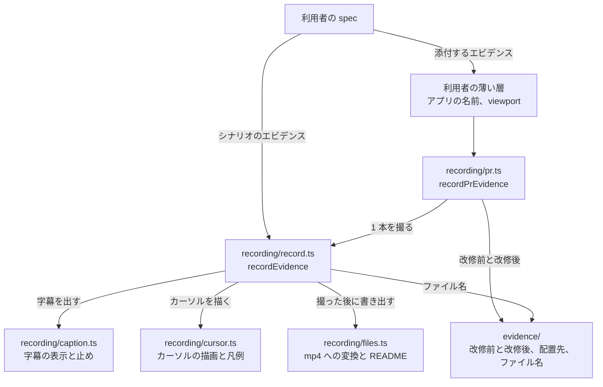
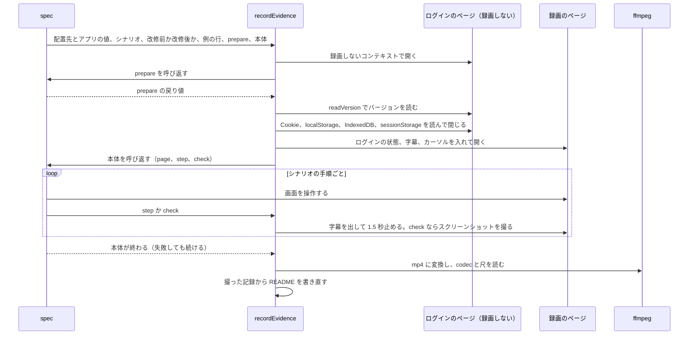

# E2E

## Overview

パッケージ e2e は、E2E のテストの書き方の判断と、テストと録画を支える kit のコードを持つ。全体像は [agent-harness Design Doc](../../design/DesignDoc.md) にある。  
kit はブラウザのテストのツール（Playwright）に依るコードなので、スキルとは別に、npm のレジストリで `@fukuemon/e2e-kit` として配る。スキルと kit は同じバージョンにする。

- ADR-0024: [パッケージごとにバージョンを上げ、e2e の kit を npm のレジストリで配る](../../adr/0024-per-package-versions.md)

## Scope

- 持つもの
  - E2E のテストの層、配置先、名前、待ち方、確認の方法の判断（スキル write-e2e-test）
  - kit のコード。録画、エビデンスの名前と置き場、ログインの保存
  - テストの書き方を止める lint の規則
- 持たないもの
  - 利用者のリポジトリの値（画面 ID の形、ログインの手順、環境の URL、worker の数）。利用者の `context/testing/e2e.md` と、kit の引数が持つ。
  - 観点の設計、エビデンスの添付、撮影の手段の選び方。verification が持つ。
  - 判定。見た目と操作感の判定は、人が動画を見て行う。

## Design

### スキル

| スキル | 担う手順 |
| --- | --- |
| write-e2e-test | テストのコードの層、置き場、名前、待ち方、確認の方法を決めて書く |
| setup-e2e | E2E のテストのディレクトリを決め、スキルと同じバージョンの kit を入れ、雛形を写し、`context/testing/e2e.md` を埋める |

スキル write-e2e-test は、テストのコードを 6 つの層（specs、setup、screens、widgets、selectors、fixtures）に分け、どの層に置くか、何を待つか、どう確認するかを決める。  
本文はテストのツールの名前を書かず、一般の語で書く。ツールの API の名前は、利用者の `context/testing/e2e.md` の Test Tool のセクションが持つ。Playwright で埋めた例は `examples/e2e/` にある。

- ADR-0023: [検証、E2E、デザインシステム、画面仕様書、文書のサイトを関心ごとのパッケージにし、組み合わせは値のファイルのキーで渡す](../../adr/0023-concern-packages.md)

- 層のディレクトリの名前は、lint の規則が読むので、スキルと規則で同じにする。
- Page Object を使わず、ページを引数に取る関数を並べる。共有するのは 3 本以上の spec が使う関数だけにし、使われない関数を増やさない。
- アプリに描画の完了の信号を足さない。描画のライブラリを置き換える改修で、改修の前と後が同じ振る舞いだと示せなくなるためである。待ちは、テストの側で観測できるもの（API のレスポンス、ライブラリが作る DOM）で組み立てる。
- `context/testing/e2e.md` の骨組みは、write-e2e-test の `assets/` に置き、core の導入のスキルが利用者のリポジトリへ写す。
- テストのツールの設定、lint の設定、エビデンスの薄い層、待つ時間の名前の雛形は、利用者が選んで写すので、setup-e2e の `references/` の下に、ツールの名前のディレクトリ（`playwright/`）で置く。中は、E2E のテストのディレクトリからの相対パスで並べる。
- setup-e2e は、スキルのディレクトリの `kit-version.json` に書いた名前とバージョンの kit を、範囲にせず固定で入れる。スキルの中のファイルなら、パッケージマネージャーでもプラグインでも、スキルと一緒に届く。

### kit の構成

kit は 4 つのサブパスに分かれる。利用者のリポジトリの値は引数で受け、kit の中に業務の語を持たない。

| サブパス | 持つもの |
| --- | --- |
| `recording` | 録画の開始と終了、字幕とカーソルの重ね、操作と判定の段の記録、mp4 への変換と README の書き出し。pull request か issue に添付するエビデンスを撮る関数 |
| `evidence` | 改修前と改修後のどちらを撮るか、配置先とファイル名 |
| `auth` | ログインの状態の保存と再利用、人がファイルに書いた認証コードの読み取り |
| `eslint` | テストの書き方の lint の規則と、それを持つプラグイン |

次の図は、利用者のリポジトリの spec から kit の中のファイルへの呼び出しを示す。矢印は呼ぶ側から呼ばれる側への向きである。



### 1 本を撮る流れ

`recordEvidence` は、ログインを録画の外で済ませ、録画のコンテキストを作り直してから spec の本体を呼ぶ。`prepare` と本体は spec の関数で、`recordEvidence` が受け取って呼び返す。



- 録画のコンテキストへ持ち越すのは、Cookie、localStorage、IndexedDB と、`prepare` が最後に開いていた origin の `sessionStorage` である。`sessionStorage` は、タブを最初に開いたときだけ入れ、画面が書き換えた値を読み直しで戻さない。
- `setContent`、`about:blank`、`data:` の URL のページは、origin が opaque で `sessionStorage` が例外を投げる。持ち越しは空にし、字幕の文は `window` に置く。このページでは、読み直すと字幕の文が消える。
- `prepare` が失敗したら、録画を始めずに例外を投げ直す。本体が失敗しても、そこまでの録画を mp4 にし、README に失敗の文を書いてから、例外を投げ直す。
- 字幕の帯とカーソルの丸は popover にし、`showModal` で開いたダイアログと同じ最上位の層に出す。ダイアログが開くたびに出し直して、その上に重ねる。
- H.264 は幅か高さが奇数だと変換できないので、mp4 への変換で偶数にそろえる。
- 録画は、ページを開いた直後の何も描いていない間を持たない。判定の静止画は mp4 から抜かず、`check` の時点でスクリーンショットを撮る。

### 配置先と名前

シナリオのエビデンスは、次の形で置く。`<アクター>/` から下は、エビデンスの格納先のフォルダと同じ形である。

```text
<root>/<issue 番号>/evidence/<環境>/<実施日>/<アクター>/S<n>_<シナリオ名>/
├── README.md       撮った条件、例の行とファイルの対応、字幕の時刻とスクリーンショット
├── 01_<例の値>.mp4  比べるときは 01_<例の値>_改修前.mp4 と 01_<例の値>_改修後.mp4
├── frames/         判定の字幕を出し終えた時点のスクリーンショット
├── compare/        比べるときだけ。改修前（左）と改修後（右）のスクリーンショットを並べた 1 枚
└── .records/       撮った記録。README と比較の画像を作り直すのに使う
```

- ファイル名に入れる例の値は、パスの区切り（`/` と `\`）を `-` に置き換える。字幕と README には、置き換える前の値を出す。
- README は、撮るたびに `.records/` の記録の全部から書き直す。同じ例の行を撮り直しても、行が重ならない。
- 撮り直すときは、同じファイル名の前の撮影だけを消す。改修前と改修後を別の回に撮れる。

pull request か issue に添付するエビデンスは、`recordPrEvidence` が `<リポジトリのルート>/<置き場>/<番号>/<名前>/` に撮り、添付する mp4 を `<番号>/<名前>.mp4` にコピーする。

- 置き場の既定は `.ai-out/evidence` にする。番号は環境変数 `EVIDENCE_NO` から読む。名前は英小文字、数字、ハイフンに限る。添付したファイル名が動画の上に出るためである。
- 字幕に出すバージョンは、読み方を渡さなければ、撮った作業ツリーの `git describe` にする。改修前を撮るときは別のコードを撮っているので、空にする。
- 改修前と改修後は、環境変数 `EVIDENCE_BEFORE_URL` と `EVIDENCE_ONLY` で切り替える。改修前と改修後を 1 回で撮るか、1 回ずつ撮るかは、改修が backend を変えるかで決める。

### lint の規則

規則は、ESLint の cwd から見たテストのディレクトリ（既定は `tests`）の下だけを見る。止めるのは、層ごとに使ってよい確認、通信の差し替え、要素の指し方とセレクタの文字列での操作、spec の import と export、`widgets/` の画面 ID と遷移である。待ち方では、固定の待ち、通信が止まるのを待つこと、待つ時間の数値、値を読んでからの比較を止める。テストのツールの `test.setTimeout` のようなテストの時間の設定は、固定の待ちに数えない。  
規則はほかのライブラリに頼らない ESLint の規則にし、TypeScript を読むためのパーサーは利用者の設定で渡す。利用者のリポジトリの値は options で受ける。

| option | 渡す値 |
| --- | --- |
| `testsDir` | テストのディレクトリ。既定は `tests`。`./tests` と絶対パスも、ESLint の cwd からの相対パスにそろえて比べる |
| `fixedWaitAllowedFiles` | 固定の待ちを許すファイル。人の入力を待つときのように、画面の状態を条件にできないものだけ |
| `timeoutDefinitionFile` | 待つ時間の名前を定めるファイル。無ければ、待つ時間の数値を確認しない |
| `screenIdPattern` | `widgets/` に書いてはいけない画面 ID の形。無ければ確認しない |
| `widgetGotoAllowedUrl` | `widgets/` が開いてよい URL。既定は `/` |

### ビルドとテスト

kit の開発の依存（TypeScript、Playwright、ESLint）は、ルートの `package.json` に置く。kit の下に `node_modules` を作ると、パッケージマネージャーがローカルの `packages/e2e` を写すときに、外を指すシンボリックリンクで止まるためである。

- ソースは TypeScript で書き、相対の import に `.ts` の拡張子を付ける。型を外すだけで動く書き方に限る（`erasableSyntaxOnly`）。
- テストは、このリポジトリのほかのスクリプトと同じく、ソースの隣の `*.test.mjs` に `node:test` で書く。Node.js が型を外して `.ts` を読むので、ビルドを待たずに `pnpm test` で流れる。
  - ADR-0012: [チェックとフックのスクリプトは Node.js で書く](../../adr/0012-node-runtime.md)
- 録画とログインの保存のテストは、ブラウザのエンジンが無ければ飛ばす。録画のテストは、ffmpeg が無いときも飛ばす。CI の実行環境には、ブラウザのエンジンを入れていない。
- 型のチェックとビルドは `tsc` で行う。ビルドは、import の拡張子を `.js` に書き換えて `dist/` に JavaScript と型の宣言を書き出す。ビルドは npm のパッケージを作るときに `prepack` で流し、公開するのは `dist/` と、ルートから写す LICENSE だけにする。
- Playwright は、peer の範囲の下限（1.59.0）と同じバージョンを開発の依存に入れ、下限のバージョンで型のチェックとテストを通す。
- ESLint の peer は 9 以上にしているが、テストは開発の依存の 10 だけで流す。9 で動くかは確認していない。
- プラグイン、kit、`kit-version.json` のバージョンと名前がそろっていることを、`pnpm test` が確認する。

### 公開

kit は、e2e のリリースと同じタグから公開する。release-please の e2e の `extra-files` が、`plugin.json`、`kit/package.json`、setup-e2e の `kit-version.json` のバージョンを同じ値に書き換える。

- `release.yml` の `publish-e2e-kit` のジョブは、release-please のジョブの出力で e2e のリリースができたときだけ動く。タグを checkout し、テストと `pnpm check:kit` を通してから公開する。
- 公開は trusted publishing で行う。`id-token: write` はこのジョブだけに与え、npm のトークンを secrets に置かない。このジョブの actions は SHA で固定し、npm の CLI が trusted publishing に要る 11.5.1 より古ければ、公開の前に落とす。
- ジョブは、リポジトリの変数 `E2E_KIT_PUBLISH` が `true` のときだけ動く。信頼する発行元を登録する前に、公開が失敗するジョブを動かさないためである。変数が無いまま e2e をリリースしたときは、`warn-e2e-kit-unpublished` のジョブが、kit を公開していないことを警告に出す。最初の公開の手順は CONTRIBUTING.md にある。

## Interface

- npm のパッケージ: `@fukuemon/e2e-kit`。サブパスは `recording`、`evidence`、`auth`、`eslint`。peer は Playwright の 1.59 以上と、任意の ESLint の 9 以上。
- 読むキー: `e2e.dir`（E2E のテストのディレクトリ）。スキルが読み、スクリプトは読まないので schema を置かない。
- 利用者の context: `context/testing/e2e.md`。テストのツールでの書き方、testid の名前、lint の規則に渡す値、流すコマンドと環境、テストデータとログイン、待つ時間の決め方を持つ。
- 写す雛形: `context/testing/e2e.md` の骨組み（core の導入のスキルが写す）。テストのツールの設定、lint の設定、エビデンスの薄い層、待つ時間の名前（setup-e2e が、利用者が選んだものだけを写す）。
- このリポジトリのチェック: `pnpm test` が kit のテストを流し、`pnpm check:kit` が型のチェックを行い、ビルドして公開する中身を一覧する。CI は両方を流す。
